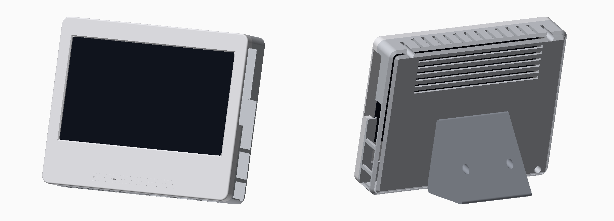

# RK3518 all-in-one

A standalone mini PC case that puts the bare RK3518 TV-box board
(`3518_ZX_4X8_V01`) behind an iPistBit **7" LCD Display-C** (1024×600, USB
touch). It looks like a small monitor: a rounded bezel with a chin, a faceted
back, a wedge stand with about 15° of recline, and passive airflow (in through
the bottom, out through the top and back).



| File | Print orientation | Notes |
|-|-|-|
| `stl/AIO-FitCheck.stl` | face down | A 4.5 mm slice of the bezel (about 20 min). **Print this first.** |
| `stl/AIO-Front.stl` | face down | Bezel and chin; holds the screen. |
| `stl/AIO-Rear.stl` | back face down | Holds the RK3518, ports and vents. The 45° faceted edges need no supports. |
| `stl/AIO-Stand.stl` | on its side | Wedge foot, attached with 2× M3. |

Overall size: 178 × 140 × 35.5 mm (without the stand).

## Ports
- **Right side:** RK3518 DC power, Ethernet, HDMI and AV. Above them is an open band
  where the screen's own HDMI, two micro-USB ports and backlight switch plug in from the side.
- **Bottom:** RK3518 microSD, USB 2.0 and USB 3.0.

Connect the two with short cables on the right-hand side:
- **HDMI:** RK3518 HDMI to the screen's "Display" port. A 15–20 cm cable with
  right-angle or flat plugs keeps it tidy.
- **USB:** RK3518 USB to the screen's "Touch" micro-USB. This powers the screen
  and carries touch input.

## Hardware
- 4× M3 × 16 screws, front to rear. They're self-tapping into the bezel; the heads
  sit in counterbores in the back.
- 2× M3 × 10 screws for the stand.
- The RK3518's original small screws (M2 / ST2.2) for its 3 standoffs.

## Before printing the big parts
1. **Screen fit:** print `AIO-FitCheck` and drop the screen in face down.
   - If the board doesn't fit, adjust `SCR_W` / `SCR_H` / `SCR_CLR`.
   - If the picture isn't centred in the window, adjust `GLASS_Y0`: the height of
     the glass's bottom edge above the bottom of the blue board. I estimated it
     from your photos (glass about 2 mm below the top edge).
2. **Board holes:** use `../microlab-trays/stl/FitCheck-RK3518.stl` to confirm the
   RK3518 hole positions (`RK_HOLES_UV`). Those values came from photos too.

Change any value in `aio.py` and regenerate:

```sh
python3 -m venv .venv && .venv/bin/pip install cadquery
.venv/bin/python aio.py
```

## Measurements used
- **Screen:** board 164.9 × 115 mm including the top tabs, 6 mm thick, glass 94 mm tall.
- **Screen ports:** HDMI, micro-USB ×2 and the backlight switch are on the right
  edge (seen from the front), 3–60 mm down from the top.
- **RK3518:** board about 85.4 × 83.5 mm, with 3 mounting holes. The board sits
  flat behind the screen with its parts facing forward and 6 mm standoffs.
